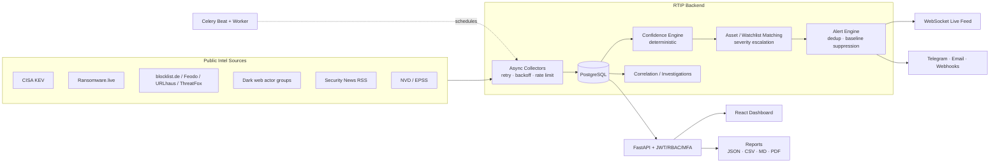

<div align="center">

# RYNEX THREAT INTELLIGENCE PLATFORM (RTIP)

### `DETECT.` &nbsp; `ANALYZE.` &nbsp; `RESPOND.`

**A centralized, continuously updated Cyber Threat Intelligence platform for Rynex Technologies.**


[Quick Start](#quick-start) · [Features](#what-runs-today) · [Leak Monitoring](#company-leak-monitoring-first-to-know) · [Architecture](#architecture) · [Intelligence Policy](#intelligence-policy) · [Security](#security) · [Docs](#documentation)

</div>

---

## Overview

RTIP aggregates intelligence from **legitimate, publicly accessible free/community-tier sources**, correlates it, **scores confidence transparently**, and generates **deduplicated, actionable alerts** - so analysts spend time on threats, not on noise.

> **Status: live and verified.** Real intelligence currently in the platform: **20,857 IOCs**, **1,769 CISA KEV vulnerabilities**, **100 ransomware breach claims (100 with victim domains)**, **419 threat actor profiles**, **277 news articles**, and **99 deduplicated alerts**. 113 backend tests pass. Full React dashboard operational.

### Why RTIP?

| | |
|---|---|
| **Real data only** | Every record has a named source, URL and timestamps. No fabricated intel. |
| **Explainable scoring** | Each confidence score ships with human-readable reasons. |
| **Low noise** | Fingerprint deduplication and first-run baseline suppression. |
| **Terms-respecting** | Per-source commercial-use status and terms are tracked. |
| **Resilient collection** | Async collectors with retries, backoff, rate limits, checkpoints and health. |

---

## What Runs Today

### Core Platform

| Capability | Status |
|---|:---:|
| FastAPI backend with JWT auth + RBAC (`admin` / `analyst` / `viewer`) | Tested |
| Normalized PostgreSQL schema (SQLAlchemy 2.0, Alembic migration `913c69783841`) | Tested |
| Collector framework (async, retries, backoff, rate limits, checkpoints, per-source health) | Tested |
| Deterministic confidence engine (no AI inside the score) | Tested |
| Alert engine (rule-based, fingerprint dedup, baseline suppression, DB-override rules) | Tested |
| Asset inventory + watchlists with severity escalation | Live verified |
| WebSocket live alert bus | Live verified |
| Celery beat scheduling | Live |

### Intelligence Sources

| Source | Type | Status |
|---|---|:---:|
| **CISA KEV** (1,769 entries) | Known exploited vulnerabilities | Live |
| **Ransomware.live** v2 API (100 recent claims, victim domains + gang claims) | Breach claims (claims only) | Live |
| **blocklist.de** (20,852 attack-source IPs, keyless) | Abuse / brute-force IPs | Live |
| **Feodo Tracker** | C2 server IPs (banking trojans) | Live |
| **Dark web actor groups** (419 profiles) | Ransomware gang monitoring | Live |
| **Security News RSS** - HN, BleepingComputer, SecurityWeek, Dark Reading, Krebs, CISA (277 articles) | News | Live |
| **NVD**, **EPSS** | CVE + exploitation probability | Implemented |
| **URLhaus** *(needs free abuse.ch key)* | Malicious URLs | Implemented |
| **ThreatFox** *(needs free abuse.ch key)* | IOCs | Implemented |
| **MISP feeds** | Private/community feeds | Implemented (config-gated) |

> Keyed sources degrade gracefully: without a key they report `misconfigured`/`degraded` in the sources UI instead of crashing the pipeline. Free abuse.ch keys: <https://auth.abuse.ch/>

### Security and Access

| Capability | Status |
|---|:---:|
| TOTP multi-factor authentication | Live verified |
| Login rate limiting (per-IP sliding window, 429 responses) | Live verified |
| Immutable audit log of admin/analyst actions | Live verified |
| Revocable API tokens | Live verified |
| Refresh-token rotation with reuse detection | Live verified |

### Analyst Experience

| Capability | Status |
|---|:---:|
| React dashboard - dark theme, `#00D4FF` accent, Recharts; alert / breach / vuln / IOC / news / source modules | Built |
| Dashboard charts + global search | Tested |
| Reports: JSON / CSV / Markdown / PDF | Built |
| Correlation to Investigations UI | Built |
| Metrics + admin endpoints | Built |
| Notifications: Telegram, SMTP email, webhooks | Implemented (config-gated) |
| Docker Compose (Postgres, Redis, API, worker, beat, frontend/nginx) | Provided |

---

## Company Leak Monitoring ("First to Know")

RTIP watches leak sites continuously so the organization hears about its own breach from the platform first:

```
Ransomware group posts victim
        |
Ransomware.live indexes it   (polled every 20 min)
        |
RTIP ingests victim + domain + gang claim
        |
Matched against YOUR registered assets and watchlists?
        |
CRITICAL alert - WebSocket banner + alert row naming the matched asset
```

- **Assets** - register owned domains, IP ranges (CIDR), product names with criticality. Intel touching them raises severity to a `high`/`critical` floor and names the asset in the alert.
- **Watchlists** - `organization` (exact match), `domain`, `actor`, `cve`, `keyword` items raise dedicated `watchlist_mention` alerts.
- **Proven with a real feed victim**: a demo asset + org watchlist caused a live Ransomware.live entry to escalate to CRITICAL with the matched asset named in the evidence.

---

## Architecture



Full details: [`docs/ARCHITECTURE.md`](docs/ARCHITECTURE.md)

---

## Live Collection Schedule

| Source | Interval |
|---|---|
| IOC feeds (URLhaus, Feodo) | every 15 min |
| ThreatFox | hourly at :05 |
| CISA KEV | hourly at :10 |
| Ransomware.live | hourly at :20 |
| blocklist.de | hourly at :25 |
| Security news RSS | every 10 min |
| Dark web actor groups | every 12 h |

---

## Quick Start

### Option A - Development

```bash
cp .env.example .env            # then edit secrets
```

**Backend**

```bash
cd backend
python3 -m venv .venv && .venv/bin/pip install -e ".[dev]"
.venv/bin/uvicorn app.main:app --reload
# API docs: http://localhost:8000/api/docs
```

**Frontend** *(separate terminal)*

```bash
cd frontend
npm install && npm run dev
# Dashboard: http://localhost:5173
```

> **Default admin (dev only):** `admin@rynex.local` / `ChangeMeNow!2024` - **change immediately.**

### Option B - Docker Compose

```bash
cp .env.example .env    # set POSTGRES_PASSWORD and JWT_SECRET_KEY
docker compose up --build
```

Brings up Postgres, Redis, API, Celery worker, Celery beat, and the frontend served by nginx.

---

## Collect Real Intelligence Now

```bash
cd backend
.venv/bin/python scripts/live_smoke.py cisa-kev
.venv/bin/python scripts/live_smoke.py security-news-rss
.venv/bin/python scripts/live_smoke.py ransomware-live
.venv/bin/python scripts/live_smoke.py blocklist-de
```

## Tests

```bash
cd backend && .venv/bin/python -m pytest tests/ -v
# 113 passed
```

---

## Intelligence Policy

RTIP is built on a few non-negotiable principles:

- **No fake data.** Every record originates from a named source with provenance (source slug, URL, timestamps).
- **Ransomware claims are never auto-confirmed.** Verification statuses are:

  `confirmed` · `reported` · `claimed` · `unverified` · `disputed`

  A leak-site listing is **always** `claimed`.
- **Baseline suppression.** The first successful collection from a source ingests history *without* generating alerts, so analysts aren't flooded by backlogs.
- **Confidence is explainable.** Every score ships with human-readable reasons; allowlisted benign infrastructure is down-weighted; AI never invents evidence inside the score.
- **Terms respected.** Per-source commercial-use status and terms are recorded in [`docs/SOURCES.md`](docs/SOURCES.md) and in the `intelligence_sources` table. Keyed sources are optional and degrade gracefully.

---

## Security

| Control | Detail |
|---|---|
| Authentication | JWT with role-based access control (`admin` / `analyst` / `viewer`), refresh rotation, MFA (TOTP) |
| Passwords | bcrypt hashing |
| Brute force | Per-IP sliding-window login rate limiting (429 on threshold) |
| Audit | Immutable audit log of admin/analyst actions |
| Transport hardening | Security headers |
| Input handling | Strict validation (Pydantic) |
| Collection safety | Per-source rate limiting, response size caps |
| SSRF protection | Config-only destinations; no user-supplied feed URLs without validation |

See [`docs/ARCHITECTURE.md`](docs/ARCHITECTURE.md) § Security.

---

## Documentation

| Doc | Purpose |
|---|---|
| [`docs/ARCHITECTURE.md`](docs/ARCHITECTURE.md) | System design and security model |
| [`docs/SOURCES.md`](docs/SOURCES.md) | Source catalog, terms and commercial-use status |
| `http://localhost:8000/api/docs` | Interactive OpenAPI docs (when running) |

---

<div align="center">

**Built by Rynex Technologies** · `DETECT. ANALYZE. RESPOND.`

</div>
