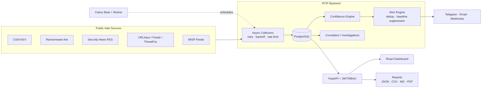

<div align="center">

# 🛡️ RYNEX THREAT INTELLIGENCE PLATFORM (RTIP)

### `DETECT.` &nbsp; `ANALYZE.` &nbsp; `RESPOND.`

**A centralized, continuously updated Cyber Threat Intelligence platform for Rynex Technologies.**


[Quick Start](#-quick-start) · [Features](#-what-runs-today) · [Architecture](#-architecture) · [Intelligence Policy](#-intelligence-policy) · [Security](#-security) · [Docs](#-documentation)

</div>

---

## 📖 Overview

RTIP aggregates intelligence from **legitimate, publicly accessible free/community-tier sources**, correlates it, **scores confidence transparently**, and generates **deduplicated, actionable alerts** - so analysts spend time on threats, not on noise.

> **Status:** Phases 1-8 core complete, live-verified. Real intelligence flows from **CISA KEV (1,700+ vulnerabilities)**, **Ransomware.live (breach claims)**, and **6 security news RSS feeds**. Full React dashboard operational.

### ✨ Why RTIP?

| | |
|---|---|
| 🔎 **Real data only** | Every record has a named source, URL and timestamps. No fabricated intel. |
| 🧮 **Explainable scoring** | Each confidence score ships with human-readable reasons. |
| 🔕 **Low noise** | Fingerprint deduplication and first-run baseline suppression. |
| ⚖️ **Terms-respecting** | Per-source commercial-use status and terms are tracked. |
| 🧱 **Resilient collection** | Async collectors with retries, backoff, rate limits, checkpoints and health. |

---

## 🚀 What Runs Today

### 🧠 Core Platform

| Capability | Status |
|---|:---:|
| FastAPI backend with JWT auth + RBAC (`admin` / `analyst` / `viewer`) | ✅ Tested |
| Normalized PostgreSQL schema (SQLAlchemy 2.0, Alembic-ready) | ✅ Tested |
| Collector framework (async, retries, backoff, rate limits, checkpoints, per-source health) | ✅ Tested |
| Confidence engine (deterministic, explainable) | ✅ Tested |
| Alert engine (rule-based, fingerprint dedup, baseline suppression) | ✅ Tested |
| Celery beat scheduling | ✅ Configured |

### 📡 Intelligence Sources

| Source | Type | Status |
|---|---|:---:|
| **CISA KEV** | Known exploited vulnerabilities | ✅ Live |
| **Ransomware.live** | Breach claims (claims only) | ✅ Live |
| **Security News RSS** - HN, BleepingComputer, SecurityWeek, Dark Reading, Krebs, CISA (165 articles) | News | ✅ Live |
| **URLhaus**, **Feodo Tracker** | Malicious URLs / C2 IOCs | ✅ Implemented |
| **ThreatFox** *(requires free Auth-Key)* | IOCs | ✅ Implemented |
| **MISP feeds** | Community feeds | ✅ Implemented |

### 🖥️ Analyst Experience

| Capability | Status |
|---|:---:|
| React dashboard - dark theme, `#00D4FF` accent, Recharts; alert / breach / vuln / IOC / news / source modules | ✅ Built |
| Dashboard charts + global search | ✅ Tested |
| Reports: JSON / CSV / Markdown | ✅ Tested |
| PDF reports | ✅ Implemented |
| Correlation → Investigations UI | ✅ Built |
| Notifications: Telegram, SMTP email, webhooks | ✅ Implemented *(config-gated)* |
| Docker Compose (Postgres, Redis, API, worker, beat, frontend/nginx) | ✅ Provided |

---

## 🏗️ Architecture



Full details: [`docs/ARCHITECTURE.md`](docs/ARCHITECTURE.md)

---

## ⚡ Quick Start

### Option A - Development

```bash
cp .env.example .env            # then edit secrets
```

**Backend**

```bash
cd backend
python3 -m venv .venv && .venv/bin/pip install -e ".[dev]"
.venv/bin/uvicorn app.main:app --reload
# API docs: http://localhost:8000/api/docs
```

**Frontend** *(separate terminal)*

```bash
cd frontend
npm install && npm run dev
# Dashboard: http://localhost:5173
```

> 🔐 **Default admin (dev only):** `admin@rynex.local` / `ChangeMeNow!2024` - **change immediately.**

### Option B - Docker Compose

```bash
cp .env.example .env    # set POSTGRES_PASSWORD and JWT_SECRET_KEY
docker compose up --build
```

Brings up Postgres, Redis, API, Celery worker, Celery beat, and the frontend served by nginx.

---

## 📥 Collect Real Intelligence Now

```bash
cd backend
.venv/bin/python scripts/live_smoke.py cisa-kev
.venv/bin/python scripts/live_smoke.py security-news-rss
.venv/bin/python scripts/live_smoke.py ransomware-live
```

## 🧪 Tests

```bash
cd backend && .venv/bin/python -m pytest tests/ -v
```

---

## 📜 Intelligence Policy

RTIP is built on a few non-negotiable principles:

- 🚫 **No fake data.** Every record originates from a named source with provenance (source slug, URL, timestamps).
- 🏴‍☠️ **Ransomware claims are never auto-confirmed.** Verification statuses are:

  `confirmed` · `reported` · `claimed` · `unverified` · `disputed`

  A leak-site listing is **always** `claimed`.
- 🔕 **Baseline suppression.** The first successful collection from a source ingests history *without* generating alerts, so analysts aren't flooded by backlogs.
- 🧾 **Confidence is explainable.** Every score ships with human-readable reasons; allowlisted benign infrastructure is down-weighted; AI never invents evidence (Phase 8+).
- ⚖️ **Terms respected.** Per-source commercial-use status and terms are recorded in [`docs/SOURCES.md`](docs/SOURCES.md) and in the `intelligence_sources` table. Keyed sources are optional and degrade gracefully.

---

## 🔒 Security

| Control | Detail |
|---|---|
| Authentication | JWT with role-based access control (`admin` / `analyst` / `viewer`) |
| Passwords | bcrypt hashing |
| Transport hardening | Security headers |
| Input handling | Strict validation (Pydantic) |
| Collection safety | Per-source rate limiting, response size caps |
| SSRF protection | Config-only destinations; no user-supplied feed URLs without validation |

See [`docs/ARCHITECTURE.md`](docs/ARCHITECTURE.md) § Security.

---

## 📚 Documentation

| Doc | Purpose |
|---|---|
| [`docs/ARCHITECTURE.md`](docs/ARCHITECTURE.md) | System design and security model |
| [`docs/SOURCES.md`](docs/SOURCES.md) | Source catalog, terms and commercial-use status |
| `http://localhost:8000/api/docs` | Interactive OpenAPI docs (when running) |

---

<div align="center">

**Built by Rynex Technologies** · `DETECT. ANALYZE. RESPOND.`

</div>
